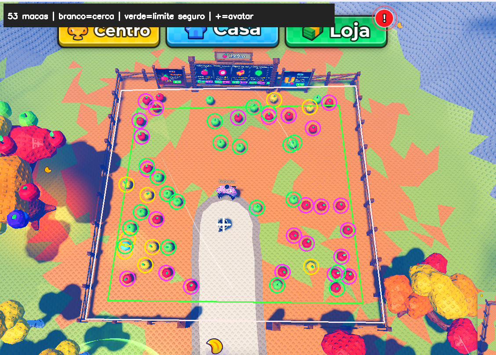
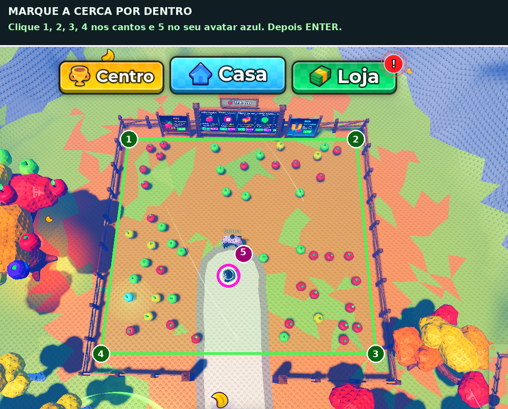
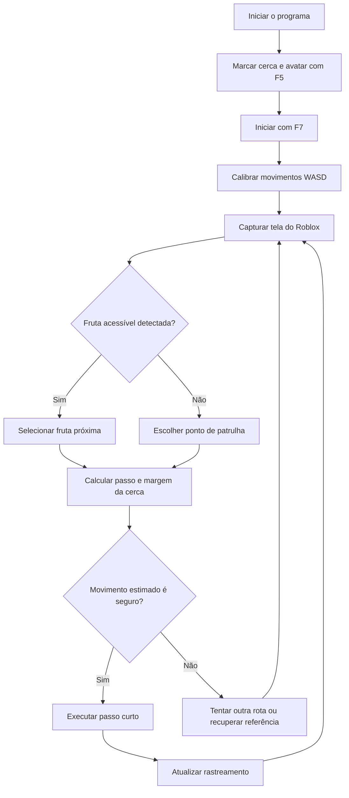

# 🍎 Roblox Apple Collector — Coletor Automático de Maçãs

> **Automação de movimentação e coleta de frutas no Roblox usando Python e visão computacional.**
>
> Projeto independente e experimental, desenvolvido para estudar processamento de imagens, rastreamento visual, controle de movimento e automação de tarefas repetitivas.


## 📌 Sobre o projeto

O **Roblox Apple Collector** é um programa em Python que observa a imagem de um jogo Roblox e tenta **identificar maçãs espalhadas em uma arena cercada**. Depois de uma calibração manual, o programa calcula movimentos de teclado para aproximar o personagem das frutas.

A ideia surgiu da necessidade de automatizar a coleta de itens em uma área específica, **sem depender de coordenadas fixas**: como a câmera acompanha o personagem, a posição aparente das maçãs e da cerca muda ao longo do tempo.

Para lidar com esse desafio, o projeto combina detecção de cores, geometria de polígonos, rastreamento de cena e pequenas correções sucessivas de rota. A versão atual é a **V6**, com coleta contínua, três níveis de velocidade e tentativa de recuperação automática quando a referência visual é perdida.

**Importante:** este é um projeto **não oficial**, sem vínculo com Roblox Corporation ou com os criadores do jogo. O uso de automações pode estar sujeito às regras da plataforma e de cada experiência. Verifique essas regras antes de executar.

## 🎯 Objetivos

- Identificar frutas em tempo real a partir de capturas de tela.
- Distinguir maçãs **vermelhas/rosas, verdes e amarelas**.
- Selecionar uma fruta próxima como destino de navegação.
- Calibrar o significado de `W`, `A`, `S` e `D` em relação à câmera.
- Restringir a movimentação a uma **região delimitada manualmente pela cerca**.
- Continuar buscando frutas e, quando necessário, patrulhar pontos internos da arena.
- Tentar recuperar o rastreamento sem exigir um novo comando de início a cada falha visual.
- Permitir ao usuário iniciar, pausar, parar e ajustar a duração dos passos pelo terminal.

## ✨ Funcionalidades da V6

| Recurso | Como funciona |
| --- | --- |
| 🍏 Detecção de frutas | Analisa a imagem por faixas de cor HSV e contornos, com filtros de tamanho e formato. |
| 🎯 Escolha do alvo | Prioriza uma fruta acessível próxima da posição estimada do personagem. |
| 🧱 Delimitação da cerca | O usuário marca quatro cantos internos; o programa mantém uma margem de segurança calculada. |
| 🧭 Calibração de movimento | Testa passos curtos para aprender o efeito de `W` e `D` na tela. |
| 📷 Rastreamento visual | Usa informações da cena e das frutas para estimar deslocamentos e pequenas alterações da câmera. |
| 🔄 Patrulha | Quando não encontra uma fruta acessível, percorre destinos internos predefinidos. |
| ♻️ Recuperação automática | Se perder a referência, mantém a sessão ativa e tenta retomar a navegação. |
| ⚡ Controle de velocidade | Três perfis que ajustam a duração máxima de cada passo. |
| 🛑 Comandos de segurança | Permite pausar ou interromper a automação manualmente. |
| 📝 Logs e diagnósticos | Registra eventos e pode salvar imagens para análise de problemas. |

### 📸 Exemplos visuais

A imagem a seguir mostra um exemplo de identificação de frutas:



Para calibrar os limites da arena, use o guia de marcação:



> Para as imagens aparecerem no GitHub, envie os arquivos `EXEMPLO_DETECCAO.png` e `GUIA_CLIQUES_CERCA.png` **na mesma pasta do `README.md`**. Eles acompanham o pacote da V6.

## 🛠️ Tecnologias utilizadas

| Tecnologia | Finalidade |
| --- | --- |
| **Python** | Lógica principal, gerenciamento do fluxo, comandos e tratamento de erros. |
| **OpenCV (`cv2`)** | Detecção de objetos por cor e contorno, geometria e rastreamento visual. |
| **NumPy** | Vetores, matrizes, distâncias, cálculos de deslocamento e transformações. |
| **MSS** | Captura de imagens da janela do jogo. |
| **PyDirectInput** | Envio dos comandos de movimentação do teclado. |
| **keyboard** | Registro dos atalhos globais `F5` a `F9`. |
| **pywin32** | Localização da janela Roblox e verificação de foco. |
| **Windows / CMD** | Ambiente de execução e interface textual do projeto. |

## 📁 Estrutura de arquivos

```text
roblox-apple-collector/
├── coletor_macas_roblox.py   # Código principal
├── INICIAR_COLETOR.bat      # Instala dependências, se necessário, e executa
├── requirements.txt         # Bibliotecas Python
├── README.md                # Documentação do projeto
├── .gitignore               # Arquivos locais que não serão versionados
├── EXEMPLO_DETECCAO.png     # Exemplo de reconhecimento de frutas
├── GUIA_CLIQUES_CERCA.png   # Exemplo da calibração da área
├── deteccao_macas.png       # Imagem demonstrativa incluída no pacote
└── LEIA_PRIMEIRO.txt        # Instruções resumidas
```

Durante a execução, o programa também pode criar `coletor_log.txt`, `cerca_calibrada.png`, `coleta_em_andamento.png`, `diagnostico_antes.png` e `diagnostico_depois.png`. **Esses arquivos são locais e não precisam ir para o GitHub.**

## 💻 Requisitos

- **Windows** com acesso ao Roblox pelo aplicativo de desktop.
- **Python 3** instalado, com o Python Launcher disponível pelo comando `py`.
- Conexão com a internet **na primeira instalação** para baixar as dependências, se ainda não estiverem instaladas.
- Janela do Roblox aberta, visível e com resolução suficiente para identificar a arena.
- Câmera em uma visão alta/superior, com o personagem dentro do cercado.

O programa automatiza a **janela do Roblox no Windows**. Ele não foi desenvolvido para rodar a coleta ao vivo em Linux, macOS, dispositivos móveis ou no navegador.

## 🚀 Instalação

### Opção 1 — Executar pelo arquivo `.bat` (recomendado)

1. Faça o download dos arquivos do repositório ou extraia o ZIP do projeto.
2. Mantenha todos os arquivos **na mesma pasta**.
3. Abra o Roblox e entre na experiência onde as frutas aparecem.
4. Execute `INICIAR_COLETOR.bat` com dois cliques.
5. O inicializador verificará as bibliotecas necessárias; se alguma estiver faltando, tentará instalá-la com o `pip`.
6. Quando aparecer o menu no CMD, faça a calibração explicada abaixo.

### Opção 2 — Executar manualmente pelo terminal

Abra o **Prompt de Comando** dentro da pasta do projeto e execute:

```bat
py -m pip install -r requirements.txt
py coletor_macas_roblox.py
```

Se `py` não for reconhecido, confira se o Python e o Python Launcher estão instalados no Windows. O projeto não precisa de compilação.

## 🎮 Como usar — passo a passo

### 1. Prepare o jogo

- Abra o Roblox e entre na área cercada onde estão as maçãs.
- Posicione o personagem **no interior da arena, longe das bordas**.
- Ajuste a câmera para observar a arena de cima.
- Evite modificar o zoom, o ângulo da câmera e o tamanho da janela após a calibração.

### 2. Marque a cerca e o personagem (`5` + Enter ou `F5`)

Com o programa aberto no CMD, digite:

```text
5
```

Pressione **Enter**, volte à janela do Roblox quando solicitado e, na imagem de calibração, marque **cinco pontos nesta ordem**:

1. Canto **superior esquerdo**, por dentro da cerca.
2. Canto **superior direito**, por dentro da cerca.
3. Canto **inferior direito**, por dentro da cerca.
4. Canto **inferior esquerdo**, por dentro da cerca.
5. Centro do **seu personagem**.

Depois de marcar os cinco pontos, pressione **Enter** para confirmar. Se errar, pressione **R** para reiniciar a marcação; **Esc** cancela.

O programa verifica se o polígono é válido e se o personagem está suficientemente afastado da cerca. A marcação é necessária **a cada nova abertura do programa**. Ela pode ser refeita depois de interromper a coleta.

### 3. Inicie a coleta (`7` + Enter ou `F7`)

No CMD, digite:

```text
7
```

Pressione **Enter** e clique novamente na janela do Roblox quando solicitado. O programa aguarda o jogo ganhar foco para começar.

Primeiro, são executados movimentos curtos para **calibrar a orientação**. Em seguida, o coletor tenta identificar as frutas e mover o personagem em direção aos alvos escolhidos.

> Mantenha o Roblox em primeiro plano. Ao clicar no CMD ou em outro aplicativo, o programa deixa de enviar os comandos de movimento até que o jogo volte a receber foco.

### 4. Acompanhe ou ajuste a velocidade

É possível digitar `1`, `2` ou `3` no CMD e pressionar Enter, mesmo durante a coleta. Depois, volte a focar o jogo.

| Comando | Modo | Duração máxima aproximada de cada passo |
| --- | --- | ---: |
| `1` + Enter | Normal | `0,14 s` |
| `2` + Enter | Rápido (**padrão**) | `0,24 s` |
| `3` + Enter | Turbo | `0,31 s` |

Esses números controlam **quanto tempo cada tecla fica pressionada**, e não a velocidade de caminhada configurada pelo Roblox. Perto da cerca, a duração do passo é reduzida automaticamente para tentar preservar a margem de segurança.

**Recomendação:** comece pelo modo `2` e use `3` somente com supervisão.

### 5. Pause, pare ou encerre

- `F9` (ou `9` + Enter) alterna entre **pausar e continuar**.
- `F8` (ou `8` + Enter) **interrompe a sessão atual e libera as teclas**.
- `0` + Enter encerra o programa.
- `Ctrl + C` no CMD também pode finalizar o processo.

**Parar (`8`) não é a mesma coisa que sair (`0`)**: após parar, você pode iniciar outra sessão sem fechar o programa.

## ⌨️ Resumo dos controles

| Atalho | Comando no CMD | Ação |
| --- | --- | --- |
| `F5` | `5` + Enter | Marcar/remarcar a cerca e o avatar. |
| `F6` | `6` + Enter | Salvar uma captura com as frutas detectadas. |
| `F7` | `7` + Enter | Iniciar a coleta e calibrar o movimento. |
| `F8` | `8` + Enter | Parar a sessão e liberar as teclas. |
| `F9` | `9` + Enter | Pausar ou retomar manualmente. |
| — | `1`, `2` ou `3` + Enter | Selecionar a velocidade. |
| — | `0` + Enter | Sair. |

Se uma tecla de função não funcionar, utilize o **comando numérico correspondente no CMD**.

## 🧠 Como o algoritmo funciona

### 1. Captura de tela

O programa localiza uma janela cujo título é `Roblox`, verifica suas dimensões e obtém imagens da área do jogo usando o MSS. Antes de enviar teclas, também confere se o Roblox está em primeiro plano.

### 2. Detecção das maçãs

Cada captura é convertida do formato **BGR para HSV** (matiz, saturação e valor). O programa aplica intervalos de cores para separar candidatos a frutas:

- **Vermelhas/rosas**;
- **Verdes**;
- **Amarelas**.

A identificação considera os contornos encontrados, filtrando pequenas regiões de cor por **área, proporção e tamanho**. Regiões fora da cerca e parte da faixa superior da interface são ignoradas para reduzir falsos positivos.

> A detecção é baseada em propriedades visuais, não em uma inteligência artificial treinada especificamente com maçãs. Objetos de aparência semelhante podem ser confundidos com frutas.

### 3. Calibração WASD

Como o jogo pode estar em uma câmera inclinada, `W` nem sempre corresponde exatamente à direção vertical da imagem. Por isso, o coletor testa movimentos breves e estima o deslocamento visual associado a duas direções principais (`W` e `D`).

Com essa informação, monta uma **matriz de movimento** usada para escolher entre `W`, `A`, `S` e `D` conforme a posição do alvo.

### 4. Acompanhamento do cenário

Quando o personagem anda e a câmera acompanha o movimento, **os objetos da tela podem se deslocar enquanto o avatar parece ficar quase parado**.

Para estimar essa mudança, o programa utiliza técnicas de correspondência visual entre capturas, incluindo informações extraídas das frutas e pontos da cena. Isso permite atualizar as coordenadas estimadas da cerca e do alvo conforme o cenário se move.

Se a câmera deixa de acompanhar o avatar em determinada posição, a V6 também tenta estimar seu movimento a partir da calibração anterior.

### 5. Navegação com limite de segurança

Os quatro cantos informados pelo usuário formam um **polígono**. Antes de cada passo, o programa avalia se o movimento previsto mantém o personagem a uma distância mínima das bordas.

- Próximo da cerca, os passos são encurtados.
- Frutas muito próximas do limite podem ser ignoradas.
- Se o personagem estiver perto da borda, o algoritmo tenta priorizar o retorno ao centro.
- Quando não há maçãs acessíveis, a navegação passa a mirar pontos internos da arena.

### 6. Tratamento de falhas e recuperação

A V6 foi projetada para não exigir um novo `F7` em toda perda temporária de rastreamento. Ela tenta readquirir referências visuais e continuar a sessão automaticamente.

**Isso não significa movimento ininterrupto:** se o programa não souber estimar a posição da cerca com segurança, **pode ficar temporariamente sem pressionar WASD** enquanto tenta se recuperar. Isso é intencional; continuar a andar cegamente aumentaria o risco de sair do cercado.

### Fluxo simplificado



O comando de parada manual (`F8` ou `8` + Enter) pode interromper esse ciclo.

## 🔬 Testar a detecção sem movimentar o personagem

Para executar apenas a análise de uma imagem existente:

```bat
py coletor_macas_roblox.py --teste captura.png
```

O programa tenta reconhecer frutas no arquivo informado e salva uma imagem com marcações. Esse modo é útil para testar filtros visuais sem enviar comandos ao Roblox.

> O teste com imagem é uma aproximação e não substitui a calibração no jogo real: ele usa uma área de referência predefinida na imagem.

## 🐛 Solução de problemas

### `F7` não inicia a coleta

1. Confirme que marcou a cerca antes com `5` + Enter.
2. No CMD, digite `7` e pressione Enter.
3. Clique na janela do Roblox quando o programa solicitar.
4. Verifique se o Roblox está aberto como janela do aplicativo Windows.

### O personagem dá poucos passos e para

Confira as mensagens finais em `coletor_log.txt`. Pode estar ocorrendo uma falha temporária de rastreamento, perda de foco da janela ou uma rota considerada insegura. Na V6, a automação **tenta se recuperar sem finalizar a sessão**, mas pode aguardar sem andar.

Também confira se a câmera, o zoom ou o tamanho da janela mudaram depois da marcação. Se mudaram, pare com `F8` e refaça a área com `F5`.

### `SEGURANCA: ... rastreamento` ou `Imagem incerta`

O programa não conseguiu confirmar o deslocamento da cena. Tente:

- Voltar a câmera para uma visão superior e estável.
- Reposicionar o personagem no interior da arena.
- Utilizar o modo de velocidade normal (`1`) para reduzir movimentos bruscos.
- Evitar elementos de interface cobrindo a cerca.
- Guardar os arquivos de diagnóstico para investigar a causa.

### Detecta frutas, mas vai para o lugar errado

- Refaça a marcação do centro do avatar.
- Confira se marcou os cantos **na ordem correta**.
- Mantenha o zoom e o ângulo da câmera estáveis.
- Experimente o modo `1` antes do modo Turbo.

### O CMD exibe avisos amarelos sobre `PATH` ou `DeprecationWarning`

Avisos do instalador ou de bibliotecas **não significam necessariamente que a execução falhou**. Veja se houve uma exceção real (`Traceback`, `ModuleNotFoundError`, `ERROR`, etc.) e se o menu aparece normalmente.

### `ModuleNotFoundError` ou biblioteca ausente

Execute novamente:

```bat
py -m pip install -r requirements.txt
```

### O programa fica parado quando abro o CMD

O bot confere se o **Roblox está em primeiro plano** antes de enviar os movimentos. Depois de digitar um comando no CMD, clique novamente no jogo para permitir a continuação.

### Arquivos para diagnóstico

Ao reportar um erro, envie preferencialmente:

- `coletor_log.txt` — histórico das mensagens.
- `diagnostico_antes.png` e `diagnostico_depois.png` — capturas salvas quando ocorre uma falha de rastreamento, caso existam.
- `coleta_em_andamento.png` — imagem do rastreamento durante a coleta, caso tenha sido criada.

Revise as imagens antes de compartilhá-las para não expor informações pessoais ou nomes de outras pessoas.

## 🔒 Segurança e limitações

- Não há **garantia de 100% de precisão** na identificação das frutas ou no controle da cerca.
- Mudanças bruscas de câmera, cenário, iluminação, escala ou interface podem prejudicar a detecção.
- Obstáculos, colisões, lag e mudanças no comportamento do Roblox podem impedir movimentos esperados.
- O código não modifica arquivos do Roblox nem interage diretamente com a API da plataforma; ele utiliza capturas de tela e simulação de teclas.
- A coleta não foi validada em todas as resoluções, computadores ou experiências do Roblox.
- A automação pode ficar **temporariamente imóvel** durante uma recuperação visual, mesmo com a sessão ativa.
- É recomendável supervisionar as primeiras execuções e ter o comando `F8` acessível.
- Use somente onde a automação for permitida pelas regras aplicáveis.

## 🗺️ Evolução do projeto

| Versão | Evolução principal |
| --- | --- |
| **V1** | Protótipo de detecção de frutas e movimentação básica. |
| **V2** | Comandos numéricos no CMD como alternativa aos atalhos. |
| **V3** | Delimitação manual da área interna da cerca. |
| **V4** | Aprimoramentos no rastreamento de cenário. |
| **V5** | Busca contínua de frutas e patrulha da arena. |
| **V6 — atual** | Recuperação automática de rastreamento e níveis de duração dos passos. |

### Possíveis melhorias futuras

- Interface gráfica para configurar a arena e iniciar/parar a coleta.
- Visualização ao vivo de alvos, rotas e bordas de segurança.
- Detecção visual mais robusta para diferentes cenários e resoluções.
- Registro de métricas de tempo de sessão, movimentação e alvos encontrados.
- Configuração persistente dos parâmetros e perfis de câmera.
- Testes automatizados de detecção e simulação de trajetórias.

## 🤝 Contribuições

Sugestões e melhorias são bem-vindas. Antes de enviar alterações, descreva o problema ou a ideia em uma *issue* e explique como reproduzir o comportamento observado. Se enviar capturas ou logs, remova dados pessoais.

## 📄 Licença

Este repositório **ainda não define uma licença de distribuição**. Se desejar autorizar formalmente a reutilização e modificação do código por outras pessoas, adicione um arquivo `LICENSE` com a licença escolhida (por exemplo, MIT). Publicar o código no GitHub, por si só, não equivale a conceder uma licença de uso.

---

**Projeto de aprendizado em Python, visão computacional e automação — versão V6.** 🍎
